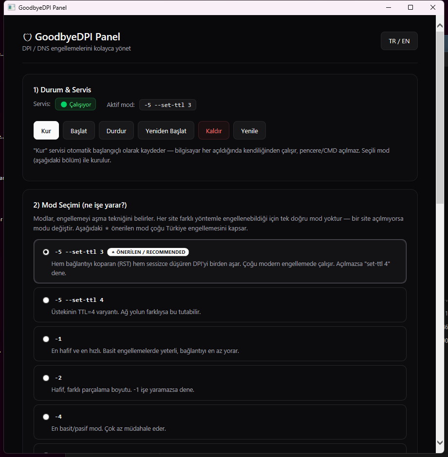

# 🛡️ GoodbyeDPI Panel

**Türkçe** | [English](#-english)



[GoodbyeDPI](https://github.com/ValdikSS/GoodbyeDPI) için, kullanımı **çok kolay** bir Windows kontrol paneli. DPI (Derin Paket İncelemesi) ve DNS engellemelerini aşmak için GoodbyeDPI'yi bir **Windows servisi** olarak kurar, ayarlarını tek bir pencereden yönetmeni sağlar. **GoodbyeDPI paketle gelir** (`bin\x86_64`, `bin\x86`), ayrıca indirmen gerekmez.

> Yeni başlayanlar için sade ve anlaşılır arayüz — her ayarın ne işe yaradığı açıkça yazılır.

> ⚠️ **Dürüst not:** Hiçbir mod her sağlayıcıda ve her hatta garanti çalışmaz. Sağlayıcılar DPI ayarlarını değiştiriyor; aynı sağlayıcıda bile hat hatta sonuç değişebiliyor. Panelin **"Otomatik Bul"** düğmesi modları senin hattında tek tek dener ve çalışanı kurar — kesin sonucu o verir.

---

## ⚡ Tek Tıkla Kurulum (En Kolay Yol)

1. [**⬇️ Bu repoyu indir**](../../archive/refs/heads/main.zip) (veya sayfanın üstündeki yeşil **Code** → **Download ZIP**)
2. ZIP'i bir klasöre çıkar (ör. `C:\GoodbyeDPI`)
3. **`setup.cmd`**'ye çift tıkla → UAC'ye **"Evet"** de
4. İnternet sağlayıcını seç (1-7; bilmiyorsan 7 ya da bekle)
5. **Bitti!** GoodbyeDPI servis olarak kurulur, DoH (şifreli DNS) açılır, panel açılır.
6. Discord açılmazsa panelde **"Otomatik Bul & Uygula"**ya bas.

> **Alternatif:** `Start-Panel.cmd`'ye çift tıkla → panel açılır → **"Kur"**.

---

## ✨ Özellikler

- 📦 **GoodbyeDPI dahil** — Resmi 0.2.3rc3 sürümü değiştirilmeden `bin\` içinde gelir; makinenin mimarisine göre (64/32 bit) doğru dosya seçilir. `bin\` silinmişse aynı sürüm GitHub'dan indirilir ve SHA-256 ile doğrulanır.
- 🟢 **Servis yönetimi** — Tek tıkla Kur / Kaldır / Başlat / Durdur / Yeniden Başlat. Otomatik başlangıç, CMD penceresi yok.
- 🏷️ **Sağlayıcıya göre öneri** — Türk Telekom, TurkNet, Superonline, Vodafone, Kablonet, Millenicom için topluluğun çalıştığını bildirdiği mod (kaynaklı, aşağıdaki tabloya bak).
- 🪄 **Otomatik en iyi modu bul** — Modları sırayla dener; Discord'un API'si, gateway'i, CDN'i ve **güncelleyicisi (updates.discord.com)**, senin yazdığın site ve genel internet açılınca durur ve o modu kurar.
- 🔒 **Geri alınabilir DoH** — Windows'un DNS-over-HTTPS'ini açar (Google + Cloudflare, IPv4 + IPv6). Eski DNS ayarların yedeklenir; kapatınca aynen geri gelir.
- 🎯 **Blacklist modu** — Bypass yalnız listedeki sitelere (Discord'un tüm alan adları dahil) uygulanır; diğer siteler etkilenmez.
- 🧪 **Site erişim testi**, 🌍 **Türkçe / İngilizce**.

---

## 🏷️ Sağlayıcıya göre öneriler (topluluk bilgisi)

> Bunlar kullanıcı bildirimleridir, **sağlayıcıda ve hatta değişebilir**. Panel "Otomatik Bul"da önce seçtiğin sağlayıcının modlarını dener. Tüm sağlayıcılarda **önce DoH'u aç**: Discord Türkiye'de DNS'te de engelli.

| Sağlayıcı | İlk denenen | Sonra | Kaynak |
|---|---|---|---|
| Türk Telekom | `-5 --set-ttl 5` | `-5 --set-ttl 3`, `-5 --set-ttl 4` | [GoodbyeDPI-Turkey `turkey_dnsredir.cmd`](https://github.com/cagritaskn/GoodbyeDPI-Turkey/tree/master/windows) (varsayılan mod); geliştiricisi TT'de Discord'a girebildiğini yazıyor: [issue #28](https://github.com/cagritaskn/GoodbyeDPI-Turkey/issues/28) (01.2025) |
| TurkNet | **DoH**, sonra `-5 --set-ttl 5` | `-5 --set-ttl 3`, `-6` | Engel çoğunlukla DNS'te: Discord uygulaması "checking for updates"da takılan kullanıcıya "TurkNet yalnız DNS bazlı engelliyor, DNS'i değiştirmen yeter" denmiş ([Technopat](https://www.technopat.net/sosyal/konu/goodbyedpi-ile-discord-calismiyor.3597499/), 01.2025); TurkNet VDSL/fiber kullanıcıları DNS değiştirerek girebildiğini, bir kullanıcı IPv6'yı kapatınca düzeldiğini yazıyor ([Techolay](https://techolay.net/sosyal/konu/turknette-discorda-goodbyedpi-olmadan-girilmiyor.94180/), 03.2025). TurkNet'e özel mod kanıtı az. |
| Turkcell Superonline | `-5 --set-ttl 5` | `-5`, `-9`, `--set-ttl 3` | [GoodbyeDPI-Turkey Superonline alternatifleri](https://github.com/cagritaskn/GoodbyeDPI-Turkey/tree/master/windows) (alt. 1/3 `--set-ttl 3`, alt. 2/4 `-5`, alt. 5/6 `-9`; 3/4/5 DNS yönlendirmeli). Alt. 4 ([Technopat](https://www.technopat.net/sosyal/konu/goodbyedpi-superonlineda-calismiyor.3886809/), 08.2025) ve alt. 5 ([Techolay](https://techolay.net/sosyal/konu/goodbyedpi-ve-superonline-ikilisi-ile-discorda-uygulamadan-girebilme.108205/), 04.2025) ile girenler var; bazılarında hiçbiri tutmamış. |
| Vodafone Net | `-6` | `-5 --set-ttl 5`, `-9` | `-6` ile girildiği bildiriliyor ([Techolay](https://techolay.net/sosyal/konu/vodafone-nette-discorda-girebilmek-icin-en-iyi-yontem-nedir.194820/), 05.2026, iki kullanıcı). ⚠ Vodafone sıkı: Mart 2026'da GoodbyeDPI birden durdu, kullanıcılar SplitWire'a geçti ([Technopat](https://www.technopat.net/sosyal/konu/goodbyedpi-ile-vodafone-internette-discorda-girilemiyor.4065450/)); Eylül 2026'da benzer bildirim ([issue #164](https://github.com/cagritaskn/GoodbyeDPI-Turkey/issues/164)). |
| Türksat Kablonet | `-6` | `-5`, `-5 --set-ttl 5` | `-5` durdu, `-6` açıyor (takılma olabiliyor): [issue #59](https://github.com/cagritaskn/GoodbyeDPI-Turkey/issues/59) (03.2025) |
| Millenicom | **DoH**, sonra `-5 --set-ttl 5` | `-5 --set-ttl 3`, `-6` | Bir kullanıcı Millenicom'da DNS değiştirmenin yettiğini yazıyor ([Techolay](https://techolay.net/sosyal/konu/turknette-discorda-goodbyedpi-olmadan-girilmiyor.94180/), 03.2025); başka konuda DoH önerilmiş, Kaspersky'nin GoodbyeDPI'yi engellediği görülmüş ([Techolay](https://techolay.net/sosyal/konu/millenicomda-goodbyedpi-discord-icin-calismiyor.65274/page-2), 11.2024). |
| Bilmiyorum / Diğer | `-5 --set-ttl 3` (varsayılan) | tüm liste | — |

**Otomatik Bul sırası** (sağlayıcının modlarından sonra): `-5 --set-ttl 5`, `-5 --set-ttl 3`, `-5 --set-ttl 4`, `-6`, `-5`, `-9`, `--set-ttl 3`, `-7`, `-8`, `-2`, `-1`, `-4`.

---

## 🩺 Discord açılmıyor (güncelleme ekranında takılıyor)

Belirti: tarayıcıda bazı engelli siteler açılıyor ama **Discord masaüstü uygulaması küçük "Güncellemeler denetleniyor" penceresinde kalıyor** ve 15-20 sn'de bir yeniden deniyor. Sebep çoğunlukla:

1. **DNS:** Tarayıcı kendi "Güvenli DNS"ini kullanabilir, ama **Discord uygulaması Windows'un DNS'ini kullanır**. Discord adları sağlayıcının DNS'inde engelli olduğu için güncelleyici `updates.discord.com`'a hiç ulaşamaz. (TurkNet'te tam bu belirtiyle DNS değişikliğinin yettiği bildirildi: [Technopat](https://www.technopat.net/sosyal/konu/goodbyedpi-ile-discord-calismiyor.3597499/).)
2. **Eski blacklist:** Listede Discord'un güncelleyici/gateway/CDN alan adları yoksa GoodbyeDPI onlara bypass uygulamaz.
3. **Mod:** Senin hattında seçili mod tutmuyordur.

Adımlar:

1. Bu sürümü kur (`setup.cmd`) ya da panelde **"Seçili Modu Uygula"** de — servis yeni blacklist'le ve `--allow-no-sni` ile yeniden yazılır.
2. Panelde **"5) DoH'u Aç"**. Durum 🟢 olmalı. (Windows 10'da yerleşik DoH yok: "GoodbyeDPI DNS yönlendirme" seçeneğini işaretleyip "Seçili Modu Uygula" de.)
3. Panelde sağlayıcını seç → **"Otomatik Bul & Uygula"**. Günlükte `DNS:✔ DISCORD:✔ GATEWAY:✔ CDN:✔ UPDATES:✔ NET:✔` gören ilk mod kurulur.
   - `DNS:✖` görürsen sorun mod değil, DNS: 2. adıma dön.
4. Discord'u **saatin yanındaki simgeden sağ tık → "Discord'dan Çık"** ile tamamen kapat, yeniden aç. (Pencereyi kapatmak yetmez.) DNS değiştikten sonra `ipconfig /flushdns` da yardımcı olur (panel DoH açınca önbelleği zaten temizler).
5. Hâlâ olmuyorsa: **QUIC'i engelle (-q)** seçeneğini işaretle → "Seçili Modu Uygula"; VPN/WARP açıksa kapat; Kaspersky gibi antivirüsler WinDivert'i engelleyebilir.
6. Hiçbir mod tutmuyorsa o hatta GoodbyeDPI yetmiyor olabilir (özellikle Eylül 2026 Vodafone bildirimleri). Bu bir panel hatası değildir.

> Test notu: Yazarın test hattında şifresiz DNS sorguları (8.8.8.8, 9.9.9.9 ve GoodbyeDPI'nin örnek verdiği Yandex `77.88.8.8:1253` dahil) engelli adlar için **cevapsız kaldı**, DoH ile çözüldü. Bu yüzden önce DoH önerilir; "GoodbyeDPI DNS yönlendirme" yalnız DoH'u olmayan Windows için yedek yoldur.

---

## 📦 Kurulum (Detaylı)

### Yol A: Otomatik (önerilen)

`setup.cmd`'ye çift tıkla — sağlayıcını sorar, servisi kurar, DoH'u açar, paneli açar.

### Yol B: Panelden

**`Start-Panel.cmd`**'ye çift tıkla → UAC'ye **"Evet"** → sağlayıcını seç → **"Kur"**.

> Panel yönetici yetkisiyle çalışmak zorundadır (servis ve DNS ayarlarını değiştirebilmek için). Bu yüzden açılışta bir kez UAC sorar.

Klasör:

```
GoodbyeDPI-Panel\
├── bin\
│   ├── x86_64\  goodbyedpi.exe, WinDivert.dll, WinDivert64.sys   ← 64 bit Windows
│   ├── x86\     goodbyedpi.exe, WinDivert.dll, WinDivert32.sys   ← 32 bit Windows
│   └── SHA256SUMS.txt
├── licenses\                ← GoodbyeDPI (Apache-2.0), WinDivert (LGPLv3/GPLv2) lisans metinleri
├── scripts\                 ← DoH aç/kapa (yedekli), bağlantı testi, yedek indirici
├── GoodbyeDPI-Panel.hta     ← arayüz
├── Start-Panel.cmd          ← başlatıcı (buna çift tıkla)
├── setup.cmd                ← ⚡ tek tıkla kurulum
├── install.cmd              ← (opsiyonel) komut satırından kurulum: install.cmd [mod]
├── uninstall.cmd            ← (opsiyonel) kaldırma (+ DoH geri alma sorusu)
├── blacklist.txt            ← bypass uygulanacak siteler
└── THIRD_PARTY_NOTICES.md   ← sürüm, kaynak adresleri, SHA-256
```

- **ARM64 Windows desteklenmez** (WinDivert'in ARM64 sürücüsü yok).
- **Windows 10:** Windows'un yerleşik DoH'u yok; panel bunu söyler ve DNS yönlendirme seçeneğini önerir.

### Eski bir kurulumu güncelleme

Eski sürüm (`goodbyedpi.exe` panelle aynı klasörde, servis `--blacklist` olmadan) için:

1. Bu repoyu indirip çıkar ya da dosyaları eski klasörün **üzerine kopyala** (ör. `C:\Program Files\GoodbyeDPI`). `bin\` gelir; panel artık onu kullanır. Eski kökteki `goodbyedpi.exe` yedek olarak kalabilir.
2. `Start-Panel.cmd` → **"Seçili Modu Uygula"** (ya da `setup.cmd`). Servis `bin\x86_64\goodbyedpi.exe <mod> --blacklist "...\blacklist.txt" --allow-no-sni` olarak yeniden yazılır.
3. DoH eski panelle açıldıysa yedeği yoktur: kapatırsan ağ kartı DNS'i otomatiğe (DHCP) alınır.

---

## 🎚️ Modlar ne işe yarar?

Modlar, engellemeyi aşma **tekniğini** belirler (GoodbyeDPI 0.2.3rc3). Tek doğru mod yoktur.

| Mod | Açıklama |
|-----|----------|
| ⭐ `-5 --set-ttl 3` | **Varsayılan.** Parçalama + TTL=3 sahte paket. Yazarın hattında test edildi. |
| `-5 --set-ttl 5` | GoodbyeDPI-Turkey varsayılanı (TT / Superonline'da yaygın). |
| `-5 --set-ttl 4` | Aynısı, TTL=4. |
| `-6` | Sahte paket geçmiş sıra numarasıyla (wrong-seq). Vodafone / Kablonet bildirimleri. |
| `-5` | TTL'i otomatik seçer (auto-ttl). |
| `-9` | GoodbyeDPI'nin kendi varsayılanı: wrong-seq + wrong-chksum + QUIC engelleme. |
| `--set-ttl 3` | Yalnız sahte paket, parçalama yok (Superonline alternatifi). |
| `-7` / `-8` | wrong-chksum / wrong-seq + wrong-chksum. Sanal makinede ya da bazı modemlerde çalışmayabilir. |
| `-2` / `-1` / `-4` | Eski (legacy) modlar; güncel DPI'de genelde yetmez. |

**Ek bayraklar (panel ekler):**
- `--blacklist blacklist.txt` — bypass yalnız listedeki sitelere.
- `--allow-no-sni` — blacklist varken eklenir. Chromium/Electron (Discord uygulaması dahil) post-quantum (Kyber) ClientHello'yu 2 TCP parçasına bölüyor; SNI ilk parçada değilse GoodbyeDPI listeyle eşleyemiyor ([upstream #330](https://github.com/ValdikSS/GoodbyeDPI/issues/330)). Bu bayrak SNI'si bulunamayan bağlantılara da bypass uygular.
- `-q` (seçenek) — QUIC/HTTP3'ü engeller, uygulamalar TCP'ye düşer.
- DNS yönlendirme (seçenek) — `--dns-addr 77.88.8.8 --dns-port 1253` (+ IPv6), GoodbyeDPI README'sindeki örnek.

---

## 🧠 Bunlar ne demek?

- **DPI (Derin Paket İncelemesi):** İnternet sağlayıcın trafiğine bakıp hangi siteye gittiğini anlar ve engeller. GoodbyeDPI, bu incelemeyi şaşırtacak şekilde paketleri parçalar/değiştirir.
- **SNI engelleme:** HTTPS bağlanırken hangi siteye gittiğin (örn. `example.com`) açık yazılır. DPI bunu görüp ya bağlantıyı koparır (RST) ya da sessizce düşürür. GoodbyeDPI bu bilgiyi gizler.
- **DNS engelleme:** Site adının IP adresine çevrilmesi bozulur. **DoH (DNS-over-HTTPS)** sorguları şifreleyerek bunu aşar. GoodbyeDPI DNS'i şifrelemez; bu yüzden ikisi birlikte gerekir.

---

## 🩺 Diğer sorunlar

- **Tarayıcı kendi DNS'ini kullanıyor:** Chrome/Edge'de `Ayarlar → Gizlilik → Güvenli DNS` açık kalabilir; sorun değil. Sistem DoH'u Discord uygulaması için gerekli.
- **Panel açılmıyor:** `.hta`'ya değil **`Start-Panel.cmd`**'ye çift tıkla ve UAC'ye "Evet" de.
- **DNS'i eski haline al:** Panelde DoH anahtarını kapat (yedekten geri yükler) ya da `uninstall.cmd` sonunda "E" de.
- **Servisi tamamen kaldır:** Panelde **Kaldır**, veya `uninstall.cmd`.

---

## ⚠️ Yasal Uyarı

Bu araç bir **sansür aşma / ağ tanılama** aracıdır. Yalnızca **yasal içeriğe kişisel erişim** ve eğitim amaçlı kullan. Bulunduğun ülkenin yasalarına uymak senin sorumluluğundur. Yazar hiçbir sorumluluk kabul etmez.

---

## 🙏 Teşekkür & Lisans

- Asıl motor: **[GoodbyeDPI](https://github.com/ValdikSS/GoodbyeDPI)** © ValdikSS — Apache License 2.0. Bu repo **değiştirilmemiş 0.2.3rc3** ikili dosyalarını içerir.
- **[WinDivert](https://github.com/basil00/WinDivert)** © basil00 — LGPLv3 veya GPLv2 (seçime bağlı).
- Sürüm, kaynak adresleri, lisans metinleri ve SHA-256 özetleri: [`THIRD_PARTY_NOTICES.md`](THIRD_PARTY_NOTICES.md), [`licenses/`](licenses/).
- Sağlayıcı önerileri: [GoodbyeDPI-Turkey](https://github.com/cagritaskn/GoodbyeDPI-Turkey) ve Technopat / Techolay kullanıcı bildirimleri.
- Bu panel: MIT Lisansı ile sunulur (aşağıya bak).

---
---

## 🇬🇧 English

[Türkçe](#️-goodbyedpi-panel) | **English**

A **dead-simple** Windows control panel for [GoodbyeDPI](https://github.com/ValdikSS/GoodbyeDPI). It installs GoodbyeDPI as a **Windows service** to bypass DPI and DNS-based blocking and lets you manage it from one window. **GoodbyeDPI is bundled** (`bin\x86_64`, `bin\x86`); no separate download.

> ⚠️ **Honest note:** no mode is guaranteed on every ISP or every line. ISPs change their DPI, and results differ even within one ISP. **"Auto-Find"** tries the modes on *your* line and installs the one that works.

### ⚡ One-Click Setup

1. [**⬇️ Download this repo**](../../archive/refs/heads/main.zip) and extract it.
2. Double-click **`setup.cmd`** → **"Yes"** on UAC.
3. Pick your ISP (1-7; 7 or wait if unsure).
4. Done: service installed, DoH enabled, panel opens. If Discord won't open, click **Auto-Find & Apply**.

### ✨ Features

- 📦 **GoodbyeDPI included** — the official 0.2.3rc3 release, unmodified, in `bin\`; the right binary for 64/32-bit Windows is picked. If `bin\` is missing, the same release is downloaded and SHA-256 verified.
- 🏷️ **Per-ISP suggestions** (Türk Telekom, TurkNet, Superonline, Vodafone, Kablonet, Millenicom) with sources — community knowledge, may change.
- 🪄 **Auto-find** — stops at the first mode where Windows DNS, the Discord API, gateway, CDN and **updater (updates.discord.com)**, your site and general internet all work.
- 🔒 **Reversible DoH** — Windows DNS-over-HTTPS (Google + Cloudflare, IPv4 + IPv6); old DNS settings are backed up and restored when you switch it off.
- 🎯 **Blacklist mode** — bypass only for listed domains (all Discord domains included), `--allow-no-sni` for split post-quantum ClientHellos ([upstream #330](https://github.com/ValdikSS/GoodbyeDPI/issues/330)).
- Options: `-q` (block QUIC), GoodbyeDPI DNS redirection (`77.88.8.8:1253`, upstream example) for Windows without built-in DoH.

### 🩺 Discord stuck on "Checking for updates"

The desktop app uses **Windows DNS** (not the browser's Secure DNS), and Discord names are DNS-blocked in Turkey. Steps: apply this version (`setup.cmd` or **Apply Selected Mode**) → **Enable DoH** (Windows 10: tick *GoodbyeDPI DNS redirection* instead) → pick your ISP → **Auto-Find** → fully quit Discord from the tray icon and reopen it. If Auto-Find shows `DNS:✖`, the problem is DNS, not the mode. Still failing: try *Block QUIC*, disable VPN/WARP, check antivirus. On some lines GoodbyeDPI is simply not enough.

On the author's test line, plain DNS queries for blocked names (8.8.8.8, 9.9.9.9 and Yandex `77.88.8.8:1253`) got no answer while DoH worked, so DoH is the primary path.

### Updating an old install

Copy the new files over the old folder (e.g. `C:\Program Files\GoodbyeDPI`) and click **Apply Selected Mode** (or run `setup.cmd`): the service is rewritten to `bin\x86_64\goodbyedpi.exe <mode> --blacklist "...\blacklist.txt" --allow-no-sni`.

- **ARM64 Windows is not supported** (WinDivert has no ARM64 driver).

### 🙏 Credits & License

- **[GoodbyeDPI](https://github.com/ValdikSS/GoodbyeDPI)** © ValdikSS — Apache-2.0; bundled unmodified (0.2.3rc3).
- **[WinDivert](https://github.com/basil00/WinDivert)** © basil00 — LGPLv3 or GPLv2.
- Versions, source URLs, licence texts, SHA-256: [`THIRD_PARTY_NOTICES.md`](THIRD_PARTY_NOTICES.md), [`licenses/`](licenses/).
- This panel: MIT License (below).

### ⚠️ Disclaimer

This is a **censorship-circumvention / network-diagnostic** tool. Use it only for **personal access to legal content** and educational purposes. Complying with your country's laws is your responsibility. The author assumes no liability.

---

## 📄 License (MIT)

```
MIT License

Copyright (c) 2026 Ali Karagöz

Permission is hereby granted, free of charge, to any person obtaining a copy
of this software and associated documentation files (the "Software"), to deal
in the Software without restriction, including without limitation the rights
to use, copy, modify, merge, publish, distribute, sublicense, and/or sell
copies of the Software, and to permit persons to whom the Software is
furnished to do so, subject to the following conditions:

The above copyright notice and this permission notice shall be included in all
copies or substantial portions of the Software.

THE SOFTWARE IS PROVIDED "AS IS", WITHOUT WARRANTY OF ANY KIND, EXPRESS OR
IMPLIED, INCLUDING BUT NOT LIMITED TO THE WARRANTIES OF MERCHANTABILITY,
FITNESS FOR A PARTICULAR PURPOSE AND NONINFRINGEMENT. IN NO EVENT SHALL THE
AUTHORS OR COPYRIGHT HOLDERS BE LIABLE FOR ANY CLAIM, DAMAGES OR OTHER
LIABILITY, WHETHER IN AN ACTION OF CONTRACT, TORT OR OTHERWISE, ARISING FROM,
OUT OF OR IN CONNECTION WITH THE SOFTWARE OR THE USE OR OTHER DEALINGS IN THE
SOFTWARE.
```
